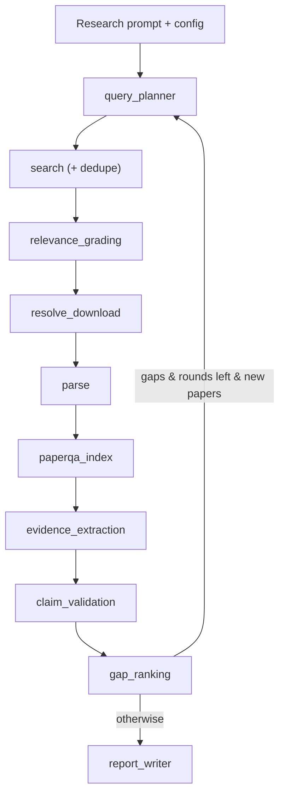

# 에이전트 그래프

SearchAgent는 9개 노드의 LangGraph `StateGraph`
(`paper_search.agent.graph.CatalystLiteratureGraph`)로 오케스트레이션됩니다. 각 노드는
deterministic 스테이지 모듈을 tool 함수로 재사용하고, 설정된 LLM provider에 따라
self-gate합니다: `llm.provider: none`이면 규칙 기반 경로, `anthropic` / `openai` /
`openai-oauth`이면 LLM + PaperQA2 추론을 추가합니다. state는
`GraphState`(`paper_search.agent.state`)로 흐르고, 오래 유지되는 의존성(HTTP, cache,
parser router, chat model)은
`AgentServices`(`paper_search.agent.services`)에 두어 노드에 주입합니다.

## 노드 맵

| 노드 (`paper_search.agent.nodes.*`) | 재사용 | Deterministic | 풀 모드 추가 |
| --- | --- | --- | --- |
| `query_planner` | `paper_search.planner` | 규칙 쿼리; 이후 라운드는 gap 조준 | + LLM 쿼리 확장 + sub-question 분해 |
| `search` | `paper_search.search.*`, `dedup` | 동시 Crossref/OpenAlex (Semantic Scholar는 1 req/s로 throttle) + 중복 제거; 라운드 누적 | — |
| `relevance_grading` | `paper_search.extraction` 용어 | 키워드 관련성 필터 | LLM이 title+abstract 채점 |
| `resolve_download` | `paper_search.resolvers.*`, `cache` | 1차 full-text resolve + download (신규 논문만) | — |
| `parse` | `paper_search.parsers.router` | JATS/GROBID/OpenDataLoader | 인덱싱용 파싱 전문 |
| `paperqa_index` | `paper_search.agent.paperqa_index` | no-op | PaperQA2 `Docs` 빌드 + 영속화 |
| `evidence_extraction` | `paper_search.extraction` | 정규식 표면 클레임 | LLM 구조화 추출(규칙 폴백) |
| `claim_validation` | `paper_search.agent.paperqa_index` | pass-through | PaperQA `agent_query`(multi-step gather), `aquery` 폴백 |
| `gap_ranking` | `paper_search.opportunities` | 규칙 opportunity 리포트 + coverage/gap 쿼리 | LLM 정제 랭킹 + LLM gap 쿼리 |
| `report_writer` | `paper_search.utils` | JSON 매니페스트 | 인용 기반 `report.md` |

연구 컨텍스트(YAML 설정, `.env` 시크릿, 사용자 프롬프트)는 그래프 실행 전에
`paper_search.config` / `paper_search.cli`가 로드합니다.

## 데이터 흐름

이 그래프를 시각적으로 실행·확인하려면 [LangGraph Studio](../user/studio.md)를
참고하세요.

## gap-driven 루프

`gap_ranking` 뒤의 조건부 엣지가 `query_planner`로 되돌아가거나 `report_writer`로
끝냅니다. **계속**하는 조건은 전부 충족될 때뿐입니다: `round <
agent.max_search_rounds`, 의미 있는 커버리지 공백이 남아 있음(누락된 claim type /
surface-mention만 있는 표면), 직전 라운드가 최소 `agent.min_new_papers_to_continue`개의
신규 관련 논문을 추가함. 라운드 상한 + 이 saturation 가드가 종료를 보장합니다. 각
라운드는 증분적입니다 — `papers`/`claims`/`processed`를 누적하고 라운드별 장부를 두어
신규 논문만 채점·다운로드·파싱·인덱싱·추출·검증합니다.

## 경계가 명확한 계약

각 노드는 좁은 입력/출력 계약을 유지하며, 이것이 그래프를 조립 가능하게 만듭니다.

- `search`는 표준 `Paper` 레코드를 반환합니다.
- `resolve_download`는 `SourceLink` 레코드와 `DownloadedSource`를 반환합니다.
- `parse`는 `ParseRun` 레코드와 블록 JSON을 반환합니다.
- `evidence_extraction`은 `SurfaceClaim` 레코드를 반환합니다(규칙 또는 LLM 구조화).
- `claim_validation`은 PaperQA 인용 기반 판정을 부착합니다.
- `gap_ranking` / `report_writer`는 의사결정 지원 리포트와 인용 기반 `report.md`를
  반환합니다.

`GraphState`는 직렬화 가능하게 유지됩니다(무거운 PaperQA `Docs`는 디스크에 영속화하고
경로로 참조). 따라서 opt-in 체크포인터(`execution.checkpoint`)로 실행을 스트리밍·영속화할
수 있습니다.

## 외부 API 카테고리

Semantic Scholar는 공개 API 엔드포인트를 서비스 카테고리로 묶습니다. SearchAgent는
`/graph/v1/paper/search`를 호출하며, 이는 단일 논문 `Paper Services`가 아니라
`Batch Paper Services` 카테고리에 속합니다. Semantic Scholar 상태나 rate-limit 동작을
해석할 때 이 카테고리를 참고하세요.

- [Semantic Scholar public API categories](https://github.com/allenai/s2-folks/blob/main/Public%20API%20Categories.md)
- [Semantic Scholar API status](https://status.api.semanticscholar.org/)

## 현재 한계

- 루프는 재검색은 하지만 논문별 `Send` 팬아웃이나 서브에이전트 실행은 안 합니다.
  sub-question은 병렬 리서처를 띄우기보다 쿼리를 확장합니다.
- 체크포인터는 opt-in이며 in-memory입니다. 교차 실행 재개의 기본 메커니즘은 산출물
  기반 resume입니다.
- 그림/표 이해는 파싱된 텍스트 블록으로 제한됩니다.
- `claim_validation`은 비용을 제한하기 위해 실행당 PaperQA 쿼리 수(고유 표면당 1개)에
  상한을 둡니다. 나머지 표면은 미검증으로 통과합니다.
