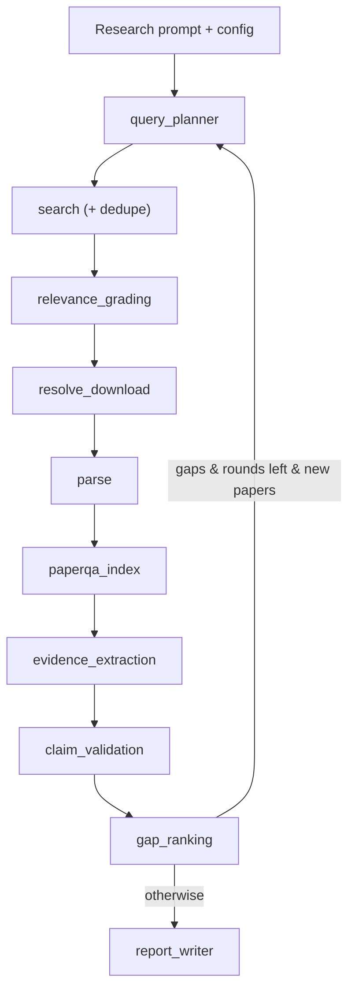

# Agent graph

SearchAgent is orchestrated as a LangGraph `StateGraph`
(`paper_search.agent.graph.CatalystLiteratureGraph`) of nine nodes. Each node
reuses a deterministic stage module as a tool-function and self-gates on the
configured LLM provider: with `llm.provider: none` it runs the rule-based path;
with `anthropic` / `openai` / `openai-oauth` it adds LLM + PaperQA2 reasoning.
State flows through a `GraphState` (`paper_search.agent.state`); long-lived
dependencies (HTTP, cache, parser router, chat model) live in `AgentServices`
(`paper_search.agent.services`) and are injected into nodes.

## Node map

| Node (`paper_search.agent.nodes.*`) | Reuses | Deterministic | Full mode adds |
| --- | --- | --- | --- |
| `query_planner` | `paper_search.planner` | rule queries; gap-targeted on later rounds | + LLM query expansion + sub-question decomposition |
| `search` | `paper_search.search.*`, `dedup` | concurrent Crossref/OpenAlex (Semantic Scholar throttled to 1 req/s) + dedupe; accumulates across rounds | — |
| `relevance_grading` | `paper_search.extraction` terms | keyword relevance filter | LLM grades title+abstract |
| `resolve_download` | `paper_search.resolvers.*`, `cache` | primary full-text resolve + download (new papers only) | — |
| `parse` | `paper_search.parsers.router` | JATS/GROBID/OpenDataLoader | parsed full text for indexing |
| `paperqa_index` | `paper_search.agent.paperqa_index` | no-op | build + persist PaperQA2 `Docs` |
| `evidence_extraction` | `paper_search.extraction` | regex surface claims | LLM structured extraction (rule fallback) |
| `claim_validation` | `paper_search.agent.paperqa_index` | pass-through | PaperQA `agent_query` (multi-step gather), `aquery` fallback |
| `gap_ranking` | `paper_search.opportunities` | rule opportunity report + coverage/gap queries | LLM-refined ranking + LLM gap queries |
| `report_writer` | `paper_search.utils` | JSON manifest | citation-grounded `report.md` |

Research context (YAML config, `.env` secrets, user prompt) is loaded by
`paper_search.config` / `paper_search.cli` before the graph runs.

## Data flow

See [LangGraph Studio](../user/studio.md) to run and inspect this graph visually.

## Gap-driven loop

After `gap_ranking`, a conditional edge either loops back to `query_planner` or
finishes at `report_writer`. It **continues** only when all hold: `round <
agent.max_search_rounds`, meaningful coverage gaps remain (missing claim types /
surface-mention-only surfaces), and the last round added at least
`agent.min_new_papers_to_continue` new relevant papers. The bounded round count
plus this saturation guard guarantee termination. Each round is incremental —
cumulative `papers`/`claims`/`processed` plus per-round bookkeeping mean only new
papers are graded, downloaded, parsed, indexed, extracted, and validated.

## Bounded contracts

Each node keeps a narrow input/output contract, which is what makes the graph
composable:

- `search` returns canonical `Paper` records.
- `resolve_download` returns `SourceLink` records and a `DownloadedSource`.
- `parse` returns `ParseRun` records and block JSON.
- `evidence_extraction` returns `SurfaceClaim` records (rule or LLM-structured).
- `claim_validation` attaches PaperQA citation-grounded verdicts.
- `gap_ranking` / `report_writer` return the decision-support report and the
  citation-grounded `report.md`.

`GraphState` is kept serializable (the heavy PaperQA `Docs` is persisted to disk
and referenced by path), so an opt-in checkpointer (`execution.checkpoint`) can
stream and persist runs.

## External API categories

Semantic Scholar groups public API endpoints into service categories. SearchAgent
calls `/graph/v1/paper/search`, which is listed under Semantic Scholar
`Batch Paper Services`, not the single-paper `Paper Services` category. Use this
category when interpreting Semantic Scholar status or rate-limit behavior.

- [Semantic Scholar public API categories](https://github.com/allenai/s2-folks/blob/main/Public%20API%20Categories.md)
- [Semantic Scholar API status](https://status.api.semanticscholar.org/)

## Current limits

- The loop re-searches but does not fan out per-paper (`Send`) or run sub-agents;
  sub-questions expand queries rather than spawning parallel researchers.
- The checkpointer is opt-in and in-memory; artifact-based resume is the primary
  cross-run mechanism.
- Figure/table understanding is limited to parsed text blocks.
- `claim_validation` caps PaperQA queries per run (one per unique surface) to
  bound cost; remaining surfaces are carried through unvalidated.
