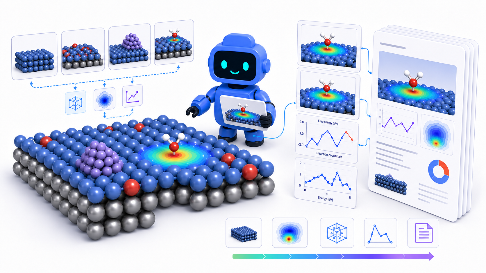

  

<h1 align="center">MESA: End-to-End Autonomous DFT Agent</h1>

  A Codex-native research agent for computational chemistry, designed to carry
  an investigation from literature understanding and hypothesis generation to
  DFT calculations, evidence validation, and manuscript-ready scientific writing.

---

MESA is an end-to-end agent for catalyst discovery and mechanistic analysis.
It connects literature understanding, atomistic modeling, calculation planning,
result analysis, figure generation, and paper drafting into one agent-driven loop.

The goal is simple: move from a research question to a publication-ready quality
computational chemistry manuscript with every claim grounded in explicit
calculations and reviewable evidence.

Our aim is simple: build an agent that can do research better than a PhD student.
That is the direction we are working toward.
