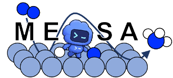
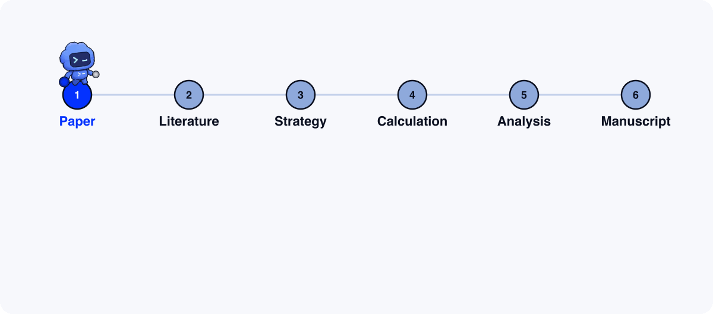

<p align="center">
  <picture>
    <source media="(prefers-color-scheme: dark)" srcset="assets/readme/logo-dark.png">
    
  </picture>
</p>

<p align="center">
  A Codex agent that proves catalyst claims with computational chemistry,<br>
  from an experimental paper to DFT evidence and a manuscript draft.
</p>

<p align="center">
  
</p>

## Setup

Open [Codex](https://github.com/openai/codex) and ask it to run `initialize-mesa`, the MESA setup skill:

```text
Clone https://github.com/GuGroup/mesa.git, link SKILL/init/initialize-mesa
into my Codex skills, and run initialize-mesa with the core runtimes.
```

It installs `uv` and the core runtimes, checks API keys, and links the MESA skills into Codex.
Put your `OPENAI_API_KEY` and `MP_API_KEY` in `DEPENDENCY/.env` when it reports them missing.

## Run

MESA runs fully autonomously. Start Codex inside `mesa/` with full access:

```bash
codex --yolo
```

**1. Create a project.** Point it at your source and pick a backend (`UMA` or `VASP`).

```text
Use initialize-project. Name: nicop-her. Source: ~/papers/nicop_her.pdf. Backend: UMA.
```

**2. Start the autonomous run.**

```text
Use start-research in full autonomous mode. Repeat strategies until the
experimental claim "Ni doping lowers the HER overpotential of CoP" is
supported by calculations, then write the manuscript.
```

It asks once for anything still missing, such as the target reaction, then runs on its own.
Everything, including the manuscript, is saved under `project/<name>/`.

Skills live in [`SKILL/`](SKILL); the full process contract is [`workflow.md`](workflow.md).
