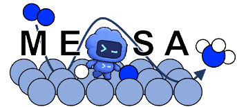

  <picture>
    <source media="(prefers-color-scheme: dark)" srcset="assets/readme/logo-dark.png">
    
  </picture>

# MESA tool-only baseline

This branch provides Codex skills for computational catalysis modeling, UMA and
VASP calculations, result analysis, plotting, and manuscript writing.

## Setup

From the checkout, ask Codex to run `initialize-mesa`. The skill checks runtimes,
helps install missing dependencies, and links the available skills into Codex.
Use an isolated `CODEX_HOME` when running this checkout alongside full MESA.
See [dependency setup](DEPENDENCY/README.md) for runtime and API-key details.

## Run

Give Codex the scientific question, supplied inputs, calculation backend,
execution limits, and requested output directory. See [workflow.md](workflow.md)
for basic tool use and [SKILL/](SKILL/) for the available skills.

## Citation

The MESA paper is in preparation. A citation will be added here on publication.
