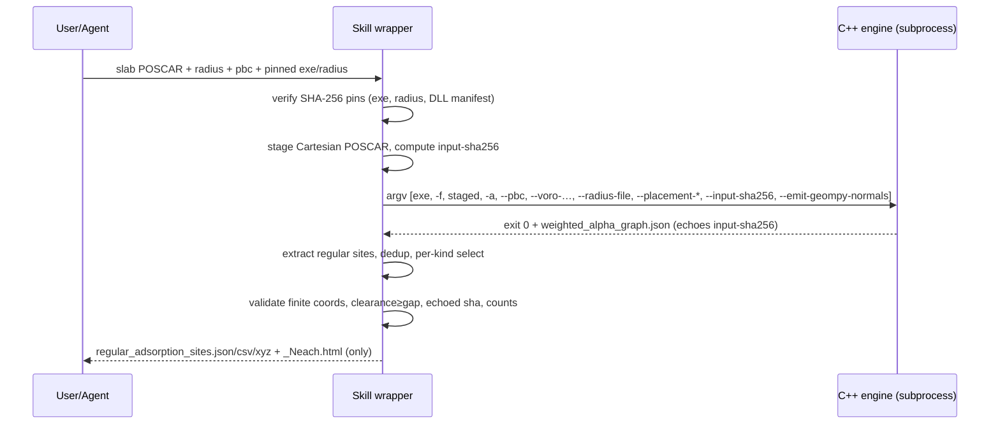

# Adsorbate ↔ Mesa Integration Design

Decision: **A. Call the pinned external `weighted_alpha_complex` executable as a subprocess**,
with the skill performing the ytk `regular_adsorption_sites` extraction/post-processing itself,
while **adopting Mesa's existing provenance machinery** (`slabuilder.weighted_alpha_backend`
contract in `WEIGHTED_ALPHA_BACKEND.md`).

## Options compared

| Criterion | A. subprocess (chosen) | B. FFI/Python binding | C. link Mesa into C++ app |
|---|---|---|---|
| Fits Mesa convention | **Yes** — `place-surface-adsorbates` already calls the engine as a subprocess | No precedent | No precedent |
| Implementation effort | Low (CLI already stable) | High (build pybind/cffi, headers) | Very high |
| Deployment | Ship pinned exe + DLLs; no build on user machine | Must compile a binding per platform/Python | Rebuild whole app |
| Error isolation | **Strong** — child crash/timeout killed via Job Object, parent survives | Weak — a C++ crash takes down Python | Weak |
| Performance | One process spawn per call (fine; runs are seconds) | Lower per-call overhead | N/A |
| ABI stability | **CLI is the contract** (stable) | Fragile C++ ABI across MSVC/mingw | Fragile |
| Testability | Golden CLI outputs; sandbox parity on graph JSON | Needs compiled module to test | Hard |
| Cross-platform | Pinned Windows exe today; CLI portable if rebuilt | Binding per platform | Worst |
| Avoids C++ duplication | **Yes** — engine does all geometry | Yes | Yes |
| Maintainability | **High** — thin wrapper | Medium | Low |

## Why not reuse `slabuilder.identify_adsorption_sites` (B-variant)

`slabuilder.weighted_alpha_backend` emits ASE `AdsorptionSite` objects filtered by MESA's
ASE-placement candidate policy (P2 must be `fcc`/`hcp`, topology-valid, non-blocking; two unique
P1 sources; ACAT-compatible mapping). The **ytk golden** was produced by the
`regular_p1_p2_with_p0_top_exception_v1` policy (P0 top surface-node exception; P1 `regular`;
**P2 regular topology**, not restricted to fcc/hcp), giving `top=5, bridge=15, hollow=12`. Routing
through `slabuilder` would change these counts and break byte-parity with the reference. Therefore
the skill keeps its own extraction and only borrows `slabuilder`'s **provenance/launch** contract.

## Provenance contract adopted (from `WEIGHTED_ALPHA_BACKEND.md`)

- Resolve engine by **explicit flag → `MESA_WEIGHTED_ALPHA_*` env**; **no PATH discovery**.
- **SHA-256 pin** the executable, radius table, and adjacent-DLL runtime manifest (+ the manifest
  itself); verify before launch; fail-closed on mismatch.
- Stage a Cartesian POSCAR (stable element-group order); pass its SHA-256 via `--input-sha256`;
  require the engine to echo it in graph metadata.
- Launch `shell=False` arg vector, private `tempfile.mkdtemp` workdir, bounded output capture,
  timeout; on Windows attach to a kill-on-close Job Object.
- Never fall back to another backend.

## Component diagram

```mermaid
flowchart LR
    subgraph Skill[place-adsorbates-with-mjs (Python, modeling env)]
      CLI[argparse CLI] --> LOC[engine locator + SHA-256 pin]
      LOC --> STG[stage POSCAR + input-sha256]
      STG --> RUN[subprocess runner]
      RUN --> EXT[extract regular P0/P1/P2]
      EXT --> WR[write json/csv/xyz + Neach.html]
    end
    RUN -. pinned exe + DLLs .-> ENG[(weighted_alpha_complex.exe\nC++: CGAL/qhull/Voro++)]
    ENG -. weighted_alpha_graph.json .-> EXT
```

## Sequence



## Mappings

- **Input**: `-f slab` → staged POSCAR `-f`; `-a radius` → `--precursor-radius` (legacy) or `-a`;
  `--engine-alpha` → `-a` (new) / alpha; `--pbc 110` → `--pbc 1,1,0`; `--placement-*` passthrough;
  fixed `--voro-construction-mode pbc_masked_image_aware`, `--emit-geompy-normals`.
- **Output**: `weighted_alpha_graph.json` → in-memory sites → `regular_adsorption_sites.{json,csv,xyz}`
  + `_{N}each.html`. Engine OBJ/hierarchy/logs are **discarded** (IP-minimal) unless `--debug`.
- **Errors**: nonzero exit / missing graph / `--input-sha256` mismatch / non-finite / empty accepted
  set → fail-closed non-zero return with a message; `--debug` preserves `engine_run/` for audit.

## Deployment / security / lifecycle

- Engine + DLLs + radius table are **not vendored** (internal-only / do-not-publish); provided by
  pinned absolute paths or `MESA_WEIGHTED_ALPHA_*` env. The published skill carries only Python +
  docs + tests.
- Per-call `tempfile.mkdtemp`; user input never overwritten; on success only the allowlisted
  artifacts are copied to `--out-dir`.
- Determinism: engine has no RNG seed; same input+flags+binary ⇒ identical graph ⇒ identical output.
- Version compatibility handled by SHA-256 pin (no `--version` on the engine).

## Test strategy

1. Post-engine parity on the committed reference `weighted_alpha_graph.json` (sandbox, no exe) —
   CSV/XYZ byte-identical, counts, 5-each ids. **Done — passes.**
2. Skill unit tests (validation, allowlist, errors) — **10/10 pass.**
3. Engine-execution smoke: run the pinned exe on the ytk slab (Windows) — covered by Mesa's own
   `verification/run_ytk_public_api_acceptance.py` (candidate_count = 32 with pinned exe).
