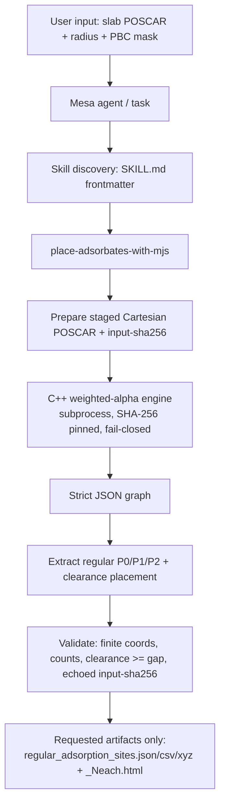

# Mesa Project Architecture Analysis — for `place-adsorbates-with-mjs`

Analysis basis (read-only):

- Mesa repo: `github.com/GuGroup/mesa`, local checkout `D:\MESA`, branch `main`, HEAD
  `be3afbc5405dec4f7457d80ccb08772a2d8ccba3`. The `D:\MESA` working tree is largely
  de-checked-out (tracked files not on disk); canonical content was read from
  `D:\MESA\mesa-main.zip` and the clean sparse checkout
  `D:\mesa_weighted_alpha_integration_sparse` (remote = `D:/MESA`, HEAD `6d38fe5`).
- C++ engine: `…\audit\hermes_implant\engine_mesa_integration_workcopy`
  (CMake project `WeightedAlphaComplex`; not a git repo — SHA-256-pinned provenance).
- Reference case: `ytk_agent_test_slab_universal_contact_NO3_radius1p52_pbc110_openmax_step0p0125`.

Location note: Mesa scopes design/reference docs under each skill's `references/`
(e.g. `SKILL/analysis/analyze-dband-center/references/`). Per the requested
"use the project's convention and report it" rule, these analysis docs live in
`SKILL/modeling/place-adsorbates-with-mjs/references/`, not a repo-root `docs/`.

## 1. Overall architecture

Mesa is a **research-paper-production monorepo**, not a generic library. Top level
(`mesa-main.zip`):

| Area | Role |
|---|---|
| `AGENTS.md`, `workflow.md`, `README.md` | Governing agent policy + end-to-end workflow. |
| `.codex/config.toml` | Codex agent configuration / skill environment wiring. |
| `SKILL/` | The published skill library (this is where our skill ships). |
| `SKILL/_shared/` | Cross-skill core (`ethics.md`, `paper-type-taxonomy.md`, `reader-workflow.md`, `terminology-ledger.md`, `journal-formats/`). |
| `ENVIRONMENT/` | Per-tool runtimes: `build_tools/` (the `modeling` env + `slabuilder` package + `.codex/skills`), `manuscript_tools/`, `paper_search/`, `vasp-submit-linker/`. |
| `DEPENDENCY/` | `runtimes.yaml` / `non_deterministic_runtimes.yaml`, `bootstrap.{ps1,sh}`. |
| `RESOURCE/` | Manuscript skeletons etc. |
| `EXTERNAL/`, `assets/` | External inputs / static assets. |

Two distinct skill homes exist:

1. **Published skills** — `SKILL/<category>/<skill-name>/` (categories seen: `analysis/`,
   `modeling/`, plus `_shared/`). Target of this task: `SKILL/modeling/place-adsorbates-with-mjs/`.
2. **Environment skills** — `ENVIRONMENT/build_tools/.codex/skills/<skill-name>/`
   (`build-slab-models`, `inspect-surface-sites`, `place-surface-adsorbates`) and
   `ENVIRONMENT/vasp-submit-linker/.codex/skills/vasp-job/`. These run inside a specific
   conda/mamba environment and back the modeling workflow.

## 2. Skill lifecycle (discovery → execution)

- **Discovery**: every skill is a directory with `SKILL.md` whose YAML frontmatter carries
  `name:` and `description:`. The description is the trigger contract (when to use the skill).
  This is the same skill format across `SKILL/**` and `.codex/skills/**`.
- **Interface**: `agents/openai.yaml` provides `interface.display_name`, `short_description`,
  and a `default_prompt` (invoked in chat as `$<skill-name>`).
- **Execution**: skills are thin — `SKILL.md` documents a CLI under `scripts/`, executed as
  `mamba run -n modeling python scripts/<script>.py …` (verbatim pattern from
  `place-surface-adsorbates/SKILL.md`). Heavy logic lives in the environment package
  (`slabuilder`) or an external engine, not in the skill wrapper.
- **References**: `references/*.md` hold input schemas and domain notes; `styles/`, `tests/`
  are optional (present in some `SKILL/analysis/*`).

## 3. Modeling-skill contract

The `modeling` env skills share one contract, which our skill must match:

- Input = a saved structure file (slab `POSCAR`/`CONTCAR`/`.vasp`/`extxyz`) plus typed CLI flags.
- POSCAR/CONTCAR/`.vasp` cannot encode a partial PBC mask, so the documented slab convention
  `pbc=[True, True, False]` is assumed (`WEIGHTED_ALPHA_BACKEND.md`).
- Output = files written to an `--outdir`/`--out-dir`, plus a concise stdout report; artifacts
  (structures/HTML) are files, not stdout.
- Determinism + validation are required (atom counts, min distance, finite coordinates, metadata).

## 4. Closest sibling skills

| Skill | Role | Input | Entry point | External program | Output | Tests | Pattern to reuse |
|---|---|---|---|---|---|---|---|
| **place-surface-adsorbates** (closest) | Identify sites **and** place adsorbates (ASE) | `--slab`, `--adsorbate` | `scripts/place_surface_adsorbates.py` via `mamba run -n modeling` | `backend=weighted_alpha` → `weighted_alpha_complex.exe` (subprocess, SHA-256 pinned) via `slabuilder.weighted_alpha_backend` | extxyz + POSCAR + JSON metadata per candidate | (env acceptance suite) | **The whole C++ integration boundary**: subprocess, arg-vector, SHA-256 pins, temp workdir, fail-closed |
| inspect-surface-sites | Read-only site/graph inspection | saved structure | `scripts/inspect_surface_sites.py` | none (reads slabuilder) | analysis JSON/text | — | Read-only reporting shape |
| build-slab-models | Build clean slabs from bulk | bulk structure | `scripts/build_slab_model.py` | none | slab files | — | `mamba run -n modeling` invocation + option-table style |

`place-surface-adsorbates` is the structural template. Difference in **output**: it emits
ASE DFT-ready structures (extxyz/POSCAR + tags), whereas `place-adsorbates-with-mjs` emits the
**ytk "regular adsorption sites" artifact set** (`regular_adsorption_sites.{json,csv,xyz}` +
`_{N}each.html`). Same engine, same integration convention, different post-processing/output.

## 5. New-skill registration point

- Directory: `SKILL/modeling/place-adsorbates-with-mjs/` (already present, following the layout
  `SKILL.md` + `agents/openai.yaml` + `references/` + `scripts/` + `tests/` + `templates/`).
- No central registry file — discovery is directory + frontmatter based. No registry edit needed.
- `agents/openai.yaml` must exist for the chat `$place-adsorbates-with-mjs` affordance (present).

## 6. C++ engine connection point

Mesa's canonical connector is `ENVIRONMENT/build_tools/slabuilder/weighted_alpha_backend.py`
(1996 lines) + `WEIGHTED_ALPHA_BACKEND.md`. Contract (must be honored):

- Resolve engine via **explicit flag → environment (`MESA_WEIGHTED_ALPHA_*`)**; **no PATH discovery**.
- **SHA-256 pin** executable + radius table + adjacent-DLL runtime manifest (+ the manifest itself);
  copy pinned artifacts into a private workdir bundle and re-verify before launch.
- Stage a Cartesian POSCAR using `stable_element_group_order`, pass its SHA-256 as `--input-sha256`;
  the engine must echo it back in graph metadata (with matching atom count + cell).
- Launch with `shell=False` argument vector, private temp workdir, minimal child env, bounded PIPE
  capture, timeout; on Windows create suspended + attach to kill-on-close **Job Object** + resume.
- Parse strict JSON graph; map graph atom IDs (0-based staged-POSCAR indices) back to ASE order.
- **Fail-closed**: missing config / hash mismatch / timeout / nonzero exit / malformed graph /
  top-layer spread > 0.25 Å / stepped upper terrace / empty candidate set → raise; never fall back.

Engine CLI surface (from `weighted_alpha_complex_refactored.cpp` arg parser):
`-f`, `-a` (contact-anchor radius; `--precursor-radius` = deprecated alias), `--alpha-factor`
(construction factor, default 1.2), `--radius-file`, `--pbc`, `--voro-construction-mode`
(`pbc_masked_image_aware`), `--placement-gap|-step|-max-distance`, `--emit-geompy-normals`,
`--input-sha256 <64hex>`.

## 7. Prohibitions / cautions

- Engine C++ source, CMake, binary, DLLs, qhull are **internal-only / do-not-publish**. The skill
  must never vendor them; it references pinned external paths only.
- Do not re-implement engine geometry in Python (sites, normals, orientation, contact placement,
  collision, periodic images are C++).
- Weighted-alpha backend is **Phase-1 gated**: pbc110 only, Cartesian +z, top-layer spread ≤ 0.25 Å;
  no tilted/bulk/molecule; no `auto` fallback.
- No hardcoded absolute paths in code; typed argument lists only (no shell string interpolation).
- Reference `engine_command.txt` passes both `-a 1.0` and `--precursor-radius 1.52`. Under the current
  binary these set the same field, so `--precursor-radius` here reflects the **legacy** binary
  semantics (`-a`=alpha, `--precursor-radius`=radius). The skill keeps them distinct via
  `--engine-alpha` vs `-a`; this divergence is documented in `cpp_adsorbate_engine_contract.md`.

## 8. Unconfirmed items

- Whether `SKILL/modeling/` on `main` is expected to also carry a `modeling/workflow.md`
  (referenced by `build-slab-models`) — not present in the current skill tree.
- Whether the published skill should call the engine **directly** (its own subprocess, as the
  current script does) or **through** `slabuilder.weighted_alpha_backend`. Decided in
  `adsorbate_mesa_integration_design.md` (Phase 3).
- Exact `modeling` env contents on the target machine (ASE presence assumed from siblings).

## 9. Flow

